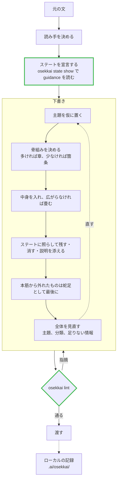

# osekkai

r-aizawa がわかりやすいと感じる文に、どんな文章もまとめるための skill と、その手順を支える lint。

## コンセプト

- **r-aizawa にわかりやすい文にまとめること**。PR 本文、issue、作業報告、調査メモ、議論の要約のすべてが下敷きにする、文章の基礎
- **手順は r-aizawa 個人のまとめ方に依存すること**。一般的な文章術ではなく、本人が例題を書いて言語化した作業順と判断をそのまま持つ。読み手を先に決め、その読み手が知らない語を消し、圧縮する方向で書く
- **意味を読む判断は skill に、文字と構造で判定できる規則と守るべき順序はバイナリに置くこと**。しきい値の数はバイナリだけが持ち、skill は鳴ったらどう直すかだけを知る
- **まとめた文章とその過程はローカルにだけ残すこと**。元の文には見せたくない情報が入りうるので、このリポジトリには架空の例題だけを置く

## 手順

太枠がバイナリの持つ段で、`osekkai steps` が印字する。残りは skill の手順で、順番を入れ替えても足してもよい。



- `osekkai` は Rust の単体バイナリで、Markdown の箇条の構造と読み手のステートを lint し、守るべき手順を印字する
- `skills/osekkai/SKILL.md` は文章をまとめる手順の skill。4 段のアンカーを持ち、`nix flake check` が順序を確かめる。nix package は同じ skill を `share/osekkai/skills/osekkai` にも入れるので、home-manager はそこを `~/.claude/skills` に指せばバイナリと skill の版が揃う

設計の経緯は `.ai/`（gitignore 下）にある。

## ローカルの記録

skill は渡した文章を `.ai/osekkai/<日付>-<題名>.md` に残す。宣言コメント、最終の本文、誰向けに書いたかを 1 ファイルにし、手順を見直すときの材料にする。`.ai/` は commit しない。実際の仕事の文章には見せたくない情報が入るので、このリポジトリに置く例題は架空のものだけにする。

## 使い方

```sh
osekkai lint <file>...              # file:line:col: rule-id: message。指摘があれば exit 1
osekkai lint --format json <file>   # textlint と同じ ruleId キーの JSON
osekkai lint --require-state <file> # 読み手のステートが宣言されていなければ指摘する
osekkai state list                  # ステートの次元と値
osekkai state show unknown=鈴木,APM purpose=inform  # そのステートの guidance と有効になる lint
osekkai steps                       # 守るべき 4 段
osekkai steps --check SKILL.md      # skill 本文のアンカーが 4 段の順で並んでいるか
```

## 読み手のステート

本文の最初のブロックに HTML コメントで宣言する。GitHub は描画しないので PR 本文に残せる。

```markdown
<!-- osekkai: unknown=鈴木,APM,840 万 history=unknown purpose=inform -->
```

次元はバイナリが持つ。`unknown` は読み手が知らない語の列挙で、何がその語かは文書ごとに書き手が決める。人名、製品名、金額はどれもその例でしかないので、種類ごとの次元は持たない。`history` と `purpose` は enum の値。読み手の目録は作らず、文書ごとに値の組み合わせで宣言する。各値は意味を読む判断の guidance と、文字と構造で判定できる lint ルールの 2 つを持ち、`state show` が両方を印字する。

## lint ルール

常時有効なもの。

| ID | 見るもの |
| --- | --- |
| `no-list-item-colon` | 箇条の中のコロン |
| `no-sentence-chain-in-list-item` | 箇条の中で「。」で文を重ねる形 |
| `no-list-item-separator` | 行頭句を ` — ` などで本文に繋ぐ形 |
| `max-list-item-lines` | 1 箇条の見た目の行数（3 行まで） |
| `max-list-block-items` | 1 つの親の下の項目数（合計 5 まで、深い階層ほど少なく） |
| `max-section-lines` | 1 節の見た目の行数（12 行まで） |
| `postscript-last` | 「蛇足」の段落が箇条の外の最後にあるか |
| `state-first` | ステートの宣言が最初のブロックにあるか |

宣言されたステートで有効になるもの。

| ID | 有効になる条件 | 見るもの |
| --- | --- | --- |
| `no-unknown-term` | 知らない語を宣言 | 宣言した語が本文に残っていないか |
| `no-heading` | 知っておく | 題名以外の見出しがないか |
| `max-top-items` | 知っておく | 最上位の項目が 4 つまでか |
| `decision-first` | 判断する | 先頭に期限と依頼があるか |
| `require-heading` | 判断する | 「案」「未確定」の章があるか |

日本語の文の規則（表記ゆれ、ですます調）は textlint に任せ、ここでは持たない。

## 開発

```sh
nix develop -c cargo test     # tests/fixtures/ の Markdown を全部 lint し、sidecar の .expect と比べる
nix flake check               # ビルド、テスト、rustfmt
```

fixture は `tests/fixtures/<rule>/{ok,ng}/*.md`。`ng` は鳴るべき `rule@line` を同名の `.expect` に書く。`tests/fixtures/examples/` は本人が受け入れた出力で、いま鳴っている指摘も sidecar に記録してある。
