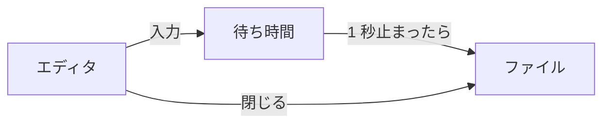

<!-- osekkai: history=known -->

## なぜやるか

入力のたびに保存が走り、長いメモでは打鍵が遅れていた。
入力が止まってからまとめて保存し、保存の回数を減らす。

## やったこと

箱は部品、矢印は保存までの流れ。
閉じるときだけ待ち時間を通らない。

- 入力が 1 秒止まったら保存する
  - 待っている間の入力は、次の保存にまとめる
- 画面を閉じるときは待たずに保存する
- 保存の回数をテストで確かめた
  - 10 回続けて打つと、保存は 1 回

## やらなかったこと

- 待ち時間を変える設定は作らない
  - 1 秒で困る例がまだない

## 資料

- 打鍵が遅れるという報告 #12
